<!-- README do perfil devmariars. Os arquivos mr-* devem estar na raiz deste repositório. -->

<a href="https://github.com/devmariars">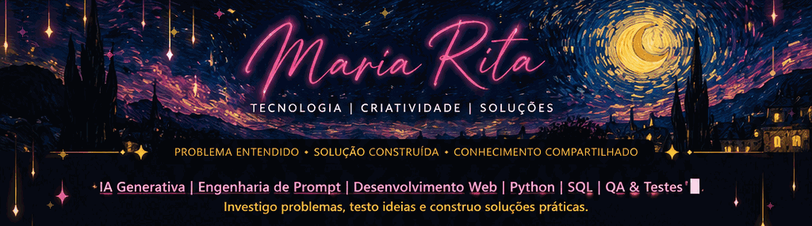</a>

<a href="https://devmariars.github.io/landingpage-mr/">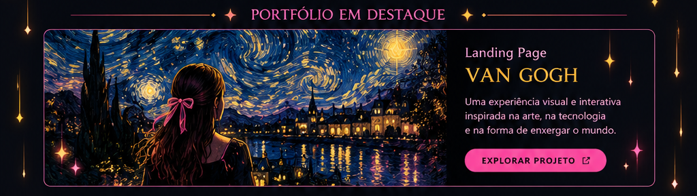</a>

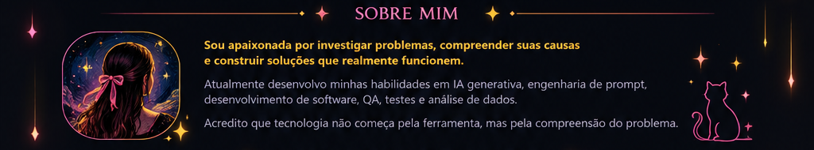

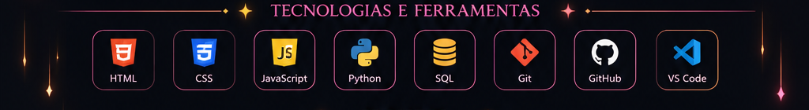

<!-- Cada metade da faixa de projetos tem seu próprio destino. -->
<a href="https://devmariars.github.io/landingpage-mr/">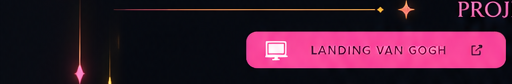</a><a href="https://github.com/devmariars?tab=repositories">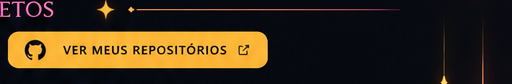</a>

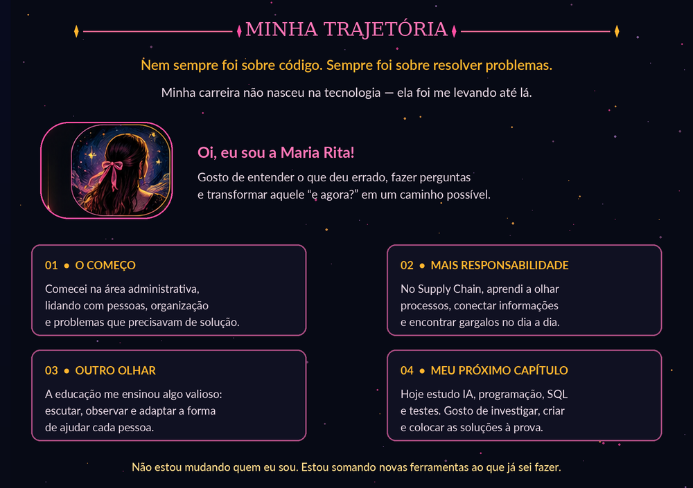

<!-- Três botões clicáveis, mantendo a composição da arte. -->
<a href="https://www.linkedin.com/in/maria-rita-7b1a39382/">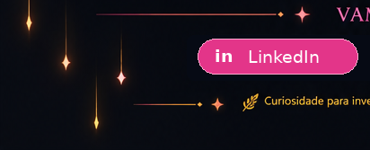</a><a href="https://github.com/devmariars">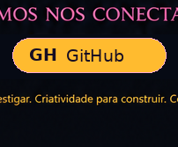</a><a href="https://wa.me/5535998246162">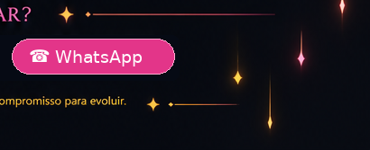</a>

**[LinkedIn](https://www.linkedin.com/in/maria-rita-7b1a39382/) · [GitHub](https://github.com/devmariars) · [WhatsApp](https://wa.me/5535998246162)**

🌌 Ver minha landing Van Gogh em movimento

<a href="https://devmariars.github.io/landingpage-mr/">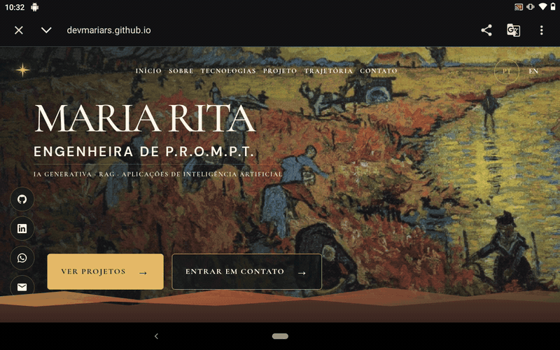</a>

